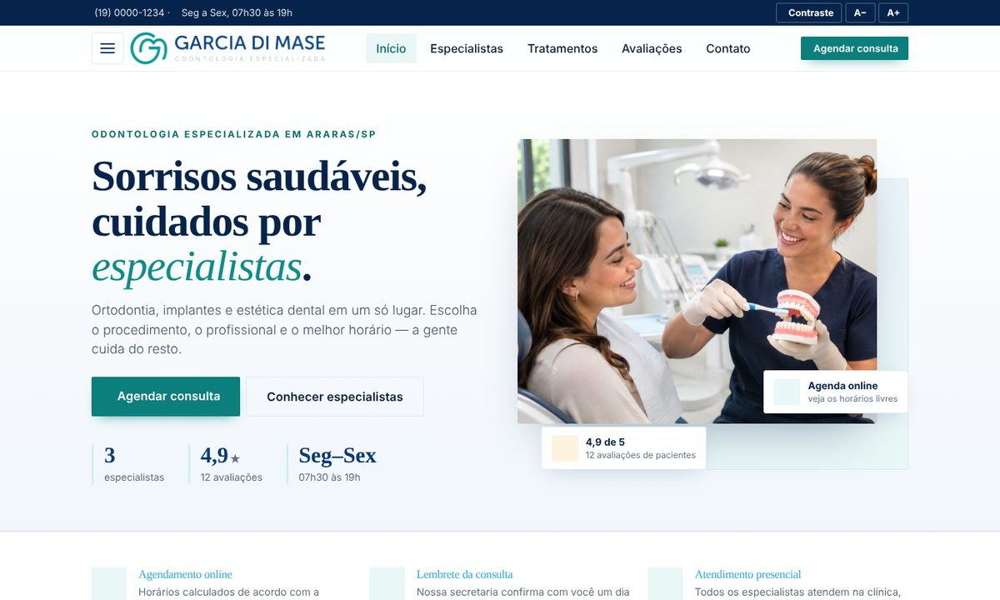
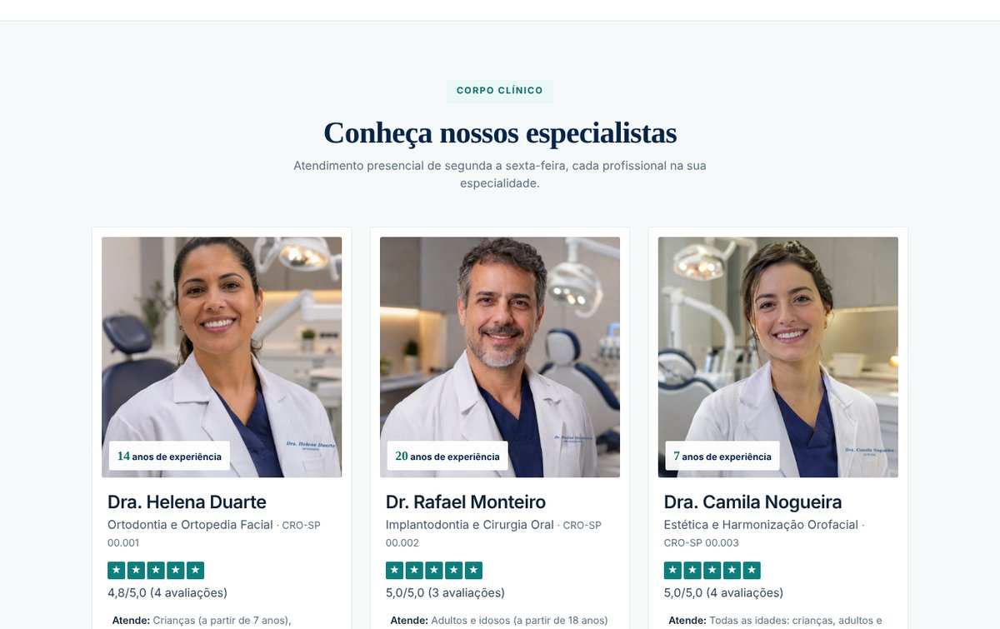
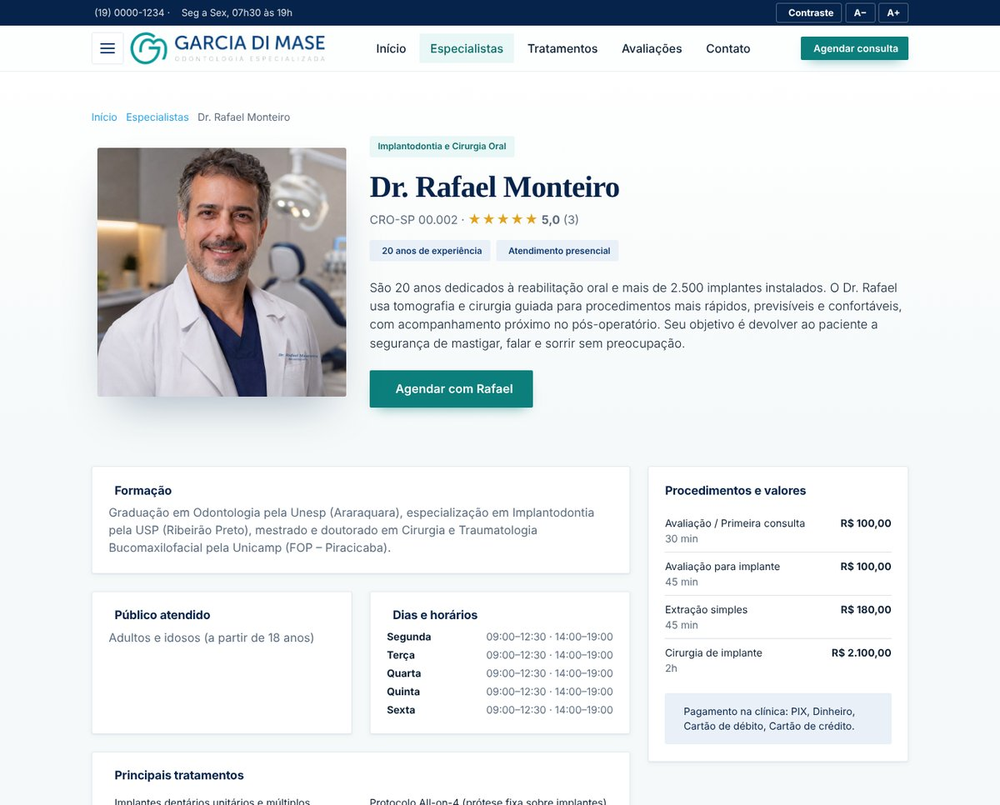
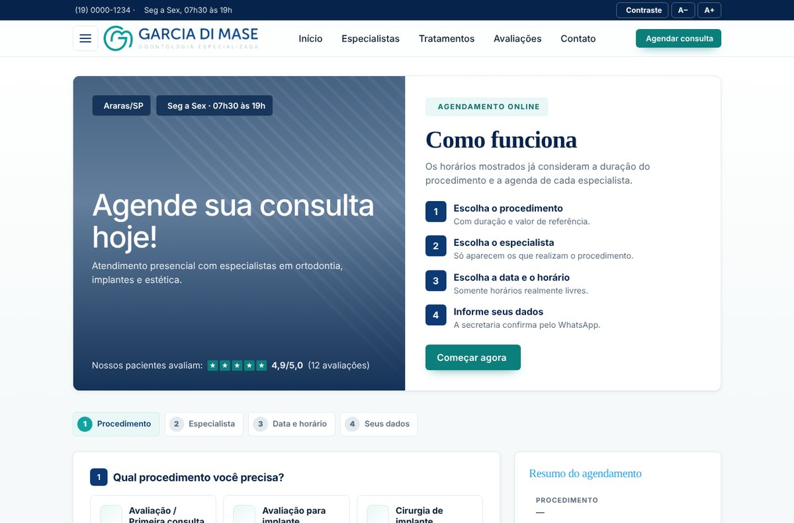
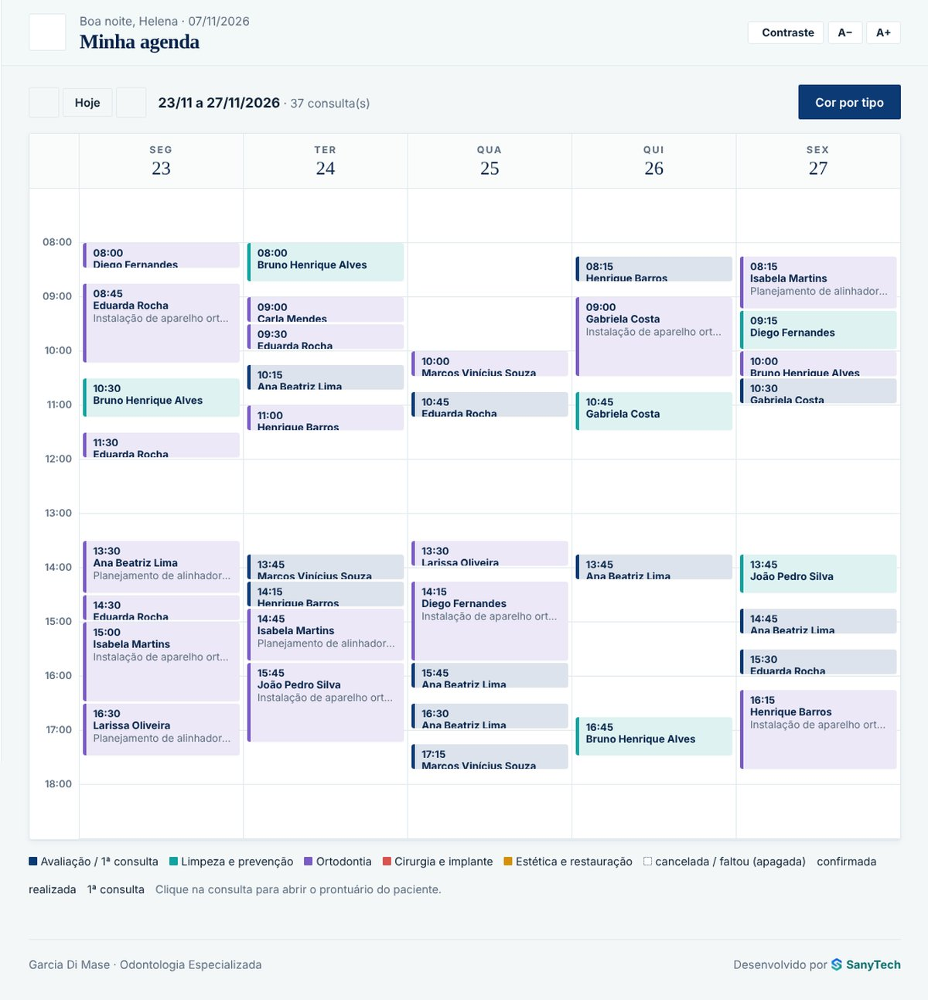
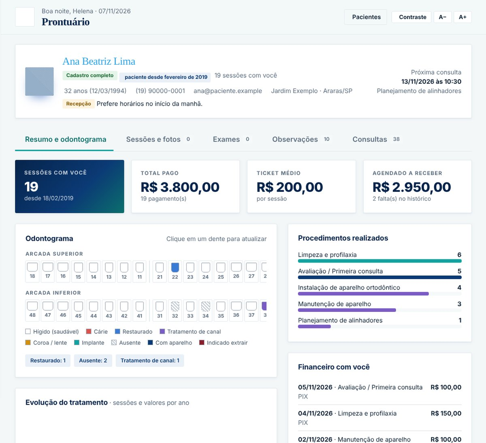

<div align="center">

<picture>
  <source media="(prefers-color-scheme: dark)" srcset="src/assets/img/logo-horizontal-branco.png">
  
</picture>

### Sistema de agendamento e gestão para clínica odontológica

Site para pacientes + área restrita para secretaria, dentistas e equipe técnica.

<br>


[Funcionalidades](#-funcionalidades) •
[Telas](#-telas) •
[Como executar](#-como-executar) •
[Estrutura](#-estrutura-do-projeto) •
[Segurança](#-segurança)

</div>

---

## 🦷 Sobre o projeto

O **Garcia Di Mase** é um sistema web completo para uma clínica odontológica **fictícia** de Araras/SP.
O paciente agenda a consulta online em poucos passos, e a clínica organiza agenda, prontuários,
financeiro e avaliações em um só lugar.

Projeto desenvolvido pela **SanyTech** no Projeto Integrador do curso de
**Desenvolvimento de Software Multiplataforma (DSM) – Fatec Araras**, 2026.2.

> [!NOTE]
> Todos os dados (nomes, telefones, e-mails, CROs, endereço e pacientes) são **fictícios** e servem apenas para demonstração.

---

## ✨ Funcionalidades

<table>
<tr>
<td width="50%" valign="top">

### 🌐 Site do paciente
- **Agendamento online em 4 passos**: procedimento → especialista → data/horário → dados
- Horários livres calculados pela **duração do procedimento** e pela agenda de cada dentista
- **Perfil de cada especialista**: formação, experiência, horários, tratamentos e antes e depois
- **Procedimentos e valores** de referência e formas de pagamento
- **Avaliações com estrelas**, aprovadas pela secretaria antes de aparecer no site
- Formulário **Fale conosco**
- Design **responsivo** (celular, tablet e computador)

</td>
<td width="50%" valign="top">

### 🗂️ Secretaria
- **Agenda semanal** colorida por tipo de procedimento
- Cadastro de pacientes com **CPF** e **CEP automático** (ViaCEP)
- **Resumo do paciente**: histórico, valores pagos e consultas
- **Financeiro** com gráficos
- Lembretes de consulta, mensagens do site e moderação de avaliações
- Tabela de **procedimentos, preços e durações** editável

</td>
</tr>
<tr>
<td width="50%" valign="top">

### 👩‍⚕️ Dentistas
- Painel com faturamento **do dia, da semana e do mês**
- Cada dentista vê **somente os seus pacientes**
- **Prontuário** com odontograma interativo, fotos por sessão, exames (PDF/imagem) e observações
- Arquivos do prontuário **protegidos**: só abrem para o dentista logado

</td>
<td width="50%" valign="top">

### 🛠️ Equipe técnica SanyTech
- Área própria para acompanhar **funcionamento, velocidade e segurança** do sistema
- Acesso separado do restante da clínica, com login forte

### ♿ Acessibilidade
- Alto contraste, ajuste do tamanho do texto (A− / A+)
- Link "pular para o conteúdo" e navegação por teclado

</td>
</tr>
</table>

---

## 📸 Telas

<table>
<tr>
<td align="center"><b>Página inicial</b><br></td>
<td align="center"><b>Nossos especialistas</b><br></td>
</tr>
<tr>
<td align="center"><b>Perfil do especialista</b><br></td>
<td align="center"><b>Agendamento online</b><br></td>
</tr>
<tr>
<td align="center"><b>Agenda do dentista</b><br></td>
<td align="center"><b>Prontuário e odontograma</b><br></td>
</tr>
</table>

---

## 🧰 Tecnologias

| Camada | Tecnologias |
|---|---|
| **Back-end** | PHP 8.2 (PDO, orientação a objetos), Apache |
| **Banco de dados** | MySQL 8.0 · phpMyAdmin |
| **Front-end** | HTML5, CSS3, JavaScript, Bootstrap 5.3, Bootstrap Icons, Chart.js |
| **Infraestrutura** | Docker e Docker Compose |
| **Integrações** | ViaCEP (preenchimento automático de endereço) |

---

## 🚀 Como executar

### Pré-requisitos
- [Docker Desktop](https://www.docker.com/products/docker-desktop/) instalado e aberto ("Engine running")
- [VS Code](https://code.visualstudio.com/) (opcional, mas recomendado)

### Passo a passo

**1. Clone o repositório**
```bash
git clone https://github.com/karlakcvs/projeto-integrador.git
cd projeto-integrador
```

**2. Crie o arquivo de configuração**
```bash
cp .env.example .env        # Windows (CMD): copy .env.example .env
```
Abra o `.env` e troque as senhas `change-this-...` por senhas suas.

**3. Suba os containers**
```bash
docker compose up -d --build
```

**4. Acesse**

| Serviço | Endereço |
|---|---|
| 🌐 Site | http://localhost |
| 🔐 Área restrita | http://localhost/login.php |
| 🗄️ phpMyAdmin | http://localhost:8888 (usuário `root`, senha do `.env`) |

Na primeira visita, o sistema **cria o banco sozinho**: tabelas, dentistas, procedimentos e uma agenda de demonstração.

**5. Defina uma senha para entrar na área restrita**

As senhas não ficam no repositório. Com o site já aberto ao menos uma vez:
```bash
docker exec -it php_apache php /var/www/html/include/redefinir_senha.php secretaria@garciadimase.example "SuaSenha#Forte2026"
```

<details>
<summary><b>👥 Contas de demonstração</b></summary>
<br>

| Perfil | E-mail |
|---|---|
| Secretaria – Juliana Prado | `secretaria@garciadimase.example` |
| Dra. Helena Duarte – Ortodontia | `helena.duarte@garciadimase.example` |
| Dr. Rafael Monteiro – Implantodontia | `rafael.monteiro@garciadimase.example` |
| Dra. Camila Nogueira – Estética | `camila.nogueira@garciadimase.example` |

A senha precisa ter no mínimo **10 caracteres**, com maiúscula, minúscula, número e símbolo.
Use o comando do passo 5 para definir a senha de cada conta.

</details>

<details>
<summary><b>🧯 Problemas comuns</b></summary>
<br>

| Problema | Solução |
|---|---|
| `port is already allocated` (porta 80 ocupada) | Feche XAMPP, Skype ou outro programa que use a porta 80 e rode `docker compose up -d` de novo |
| `container name ... is already in use` | `docker rm -f php_apache mysql_db phpmyadmin` e depois `docker compose up -d --build` |
| Erro de conexão com o banco na primeira vez | Aguarde ~1 minuto (o MySQL ainda está iniciando) e atualize a página |
| Ver o que está rodando | `docker compose ps` |
| Ver erros do PHP | `docker compose logs web` |
| Desligar | `docker compose down` (os dados ficam salvos) |

</details>

Instruções detalhadas em [LEIA-ME.md](LEIA-ME.md). O banco de demonstração para importação está em [database/](database/).

---

## 📁 Estrutura do projeto

```
📦 projeto
 ┣ 📂 database          → banco de demonstração (dados fictícios)
 ┣ 📂 docs/screenshots  → imagens deste README
 ┣ 📂 src
 ┃ ┣ 📂 api             → horários livres (JSON)
 ┃ ┣ 📂 assets          → CSS, JavaScript e imagens
 ┃ ┣ 📂 classes         → agendamento, financeiro e prontuário (POO)
 ┃ ┣ 📂 include         → configuração, segurança e migrações (bloqueada ao navegador)
 ┃ ┣ 📂 uploads         → fotos e arquivos enviados (não versionados)
 ┃ ┣ 📜 index.php       → página inicial
 ┃ ┣ 📜 agendar.php     → agendamento online
 ┃ ┗ 📜 ...             → painéis da secretaria, dos dentistas e da SanyTech
 ┣ 🐳 Dockerfile
 ┣ 🐳 docker-compose.yml
 ┗ 📄 .env.example      → modelo de configuração
```

---

## 🔒 Segurança

- Senhas guardadas apenas como **hash** (`password_hash`)
- **Proteção CSRF** em todos os formulários e **sessão protegida**
- **Limite de tentativas** no login e nos formulários públicos (contra robôs e força bruta)
- Consultas ao banco com **prepared statements** (contra SQL injection)
- Pastas internas e prontuários **bloqueados** para acesso direto pelo navegador
- Banco e phpMyAdmin acessíveis **somente no próprio computador** (`127.0.0.1`)
- Cabeçalhos de segurança no Apache e versão do servidor oculta

Detalhes em [SEGURANCA.md](SEGURANCA.md).

> [!WARNING]
> Nunca publique o arquivo `.env`, a pasta `mysql-data/` nem o conteúdo de `src/uploads/`:
> eles podem conter senhas, dados pessoais e informações de saúde.

---

## 👩‍💻 Autora

Desenvolvido com 💙 pela **SanyTech**, Projeto Integrador · DSM · Fatec Araras · 2026.2

<table>
<tr>
<td align="center">
<a href="https://github.com/karlakcvs">
<br>
<sub><b>Karla Carolina Vicente de Sousa</b></sub>
</a><br>
<sub>Desenvolvimento full stack</sub>
</td>
</tr>
</table>

---

<div align="center">
<sub>Projeto acadêmico · Clínica, profissionais e pacientes são fictícios · Fotos ilustrativas</sub>
</div>
