<a id="topo"></a>

<div align="center">

<picture>
  <source media="(prefers-color-scheme: dark)" srcset="../src/assets/img/logo-horizontal-branco.png">
  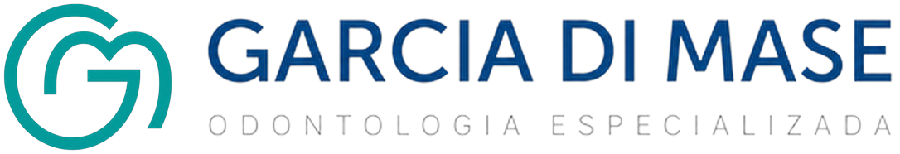
</picture>

### Sistema web de agendamento e gestão para clínica odontológica

Site para pacientes · Área restrita para secretaria, dentistas e equipe técnica

<br>

[](https://www.php.net/)
[](https://www.mysql.com/)
[](https://docs.docker.com/compose/)
[](https://getbootstrap.com/)
[](https://www.chartjs.org/)


<br>

[Visão geral](#visão-geral) ·
[Funcionalidades](#funcionalidades) ·
[Telas](#telas) ·
[Arquitetura](#arquitetura) ·
[Como executar](#como-executar) ·
[Perfis de acesso](#perfis-de-acesso) ·
[Segurança](#segurança) ·
[Documentação](#documentação)

<br>


</div>

---

## Visão geral

O **Garcia Di Mase** é um sistema web para uma clínica odontológica de Araras/SP que até então organizava as consultas em agenda de papel. Ele reúne em um só lugar o **agendamento online**, os **lembretes de consulta pelo WhatsApp** e o **acompanhamento financeiro** da clínica, além de prontuário eletrônico, gerador de atestados e uma área técnica de monitoramento.

O projeto foi desenvolvido pela **SanyTech** no Projeto Integrador do curso de **Desenvolvimento de Software Multiplataforma (DSM)** da **Fatec Araras**, em 2026.

| | |
|:--|:--|
| **4 passos** | para o paciente agendar uma consulta pelo site |
| **3 especialistas** | cada um com agenda, preços e perfil próprios |
| **4 perfis de acesso** | paciente, secretaria, dentista e equipe técnica |
| **1 clique** | para emitir um atestado pronto para imprimir ou salvar em PDF |

> [!NOTE]
> A clínica, os profissionais, os pacientes, os telefones e os endereços exibidos são **fictícios** e servem apenas para demonstração.

---

## Funcionalidades

### Site do paciente
- Página inicial com fotografia em tela cheia e informações principais visíveis sem rolagem
- **Agendamento online em quatro passos:** procedimento → especialista → data e horário → dados pessoais
- Horários livres calculados pela **duração do procedimento** e pela agenda de cada dentista, com nova verificação antes de gravar
- Página de cada especialista com formação, experiência, horários, tratamentos, preços e casos de antes e depois
- Avaliações com estrelas (publicadas somente após aprovação), perguntas frequentes, mapa e formulário de contato

### Área da secretaria
- Visão geral do dia com pendências, agenda de hoje e faturamento por dentista
- **Agenda semanal** da clínica, colorida por dentista ou por tipo de procedimento
- Cadastro de pacientes com validação de **CPF** e endereço automático pelo **CEP** (ViaCEP)
- **Lembretes pelo WhatsApp** em três etapas: enviar, marcar como enviado e confirmar presença
- **Financeiro da clínica:** totais do dia, da semana, do mês e do ano, faturamento por dentista, gráfico mês a mês, comparativo anual, faturamento diário e formas de pagamento
- Moderação de avaliações, mensagens do site e cadastro de dentistas, procedimentos e preços

### Área do dentista
- **Agenda de hoje** logo na entrada, com o próximo paciente em destaque e atalhos para prontuário e atestado
- **Meu financeiro:** previsto do dia, da semana e do mês, gráfico de 12 meses, receita por procedimento, formas de pagamento, valores a receber e recebidos
- **Gerador de atestado** de comparecimento ou de afastamento, com dados do dentista e do CRO preenchidos, código do procedimento, dias por extenso, CID opcional e impressão em A4
- **Prontuário eletrônico** com odontograma interativo, fotos por sessão, exames (PDF ou imagem), observações e gráfico de evolução do tratamento
- Edição do próprio perfil no site e moderação das avaliações recebidas
- Acesso restrito aos **próprios pacientes e valores**

### Área técnica SanyTech
- Painéis de funcionamento, desempenho e segurança, sem acesso a dados de pacientes ou financeiros

### Acessibilidade e responsividade
- Alto contraste e ajuste do tamanho do texto (A− / A+) sempre visíveis no menu
- Link para pular ao conteúdo, foco visível e navegação completa por teclado
- Layout adaptado para celular, tablet e computador, com tabelas convertidas em cartões em telas pequenas

<p align="right"><a href="#topo">voltar ao topo ↑</a></p>

---

## Telas

<table>
<tr>
<td colspan="2"><b>Site do paciente</b></td>
</tr>
<tr>
<td width="50%"><br><sub>Nossos especialistas</sub></td>
<td width="50%"><br><sub>Perfil do especialista</sub></td>
</tr>
<tr>
<td width="50%"><br><sub>Agendamento online em quatro passos</sub></td>
<td width="50%">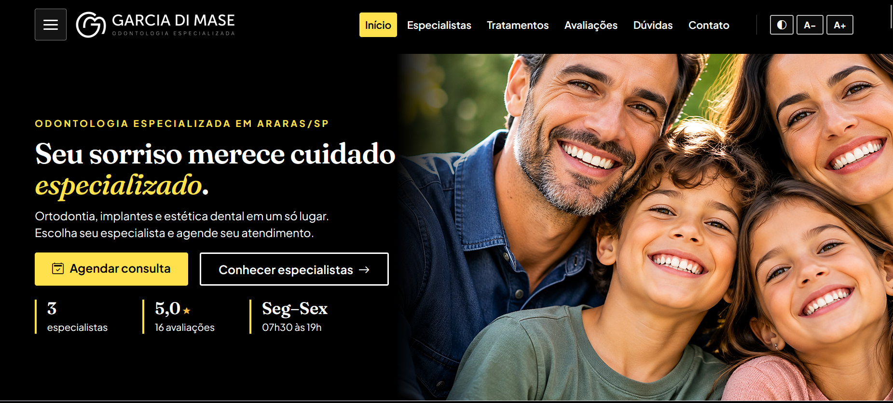<br><sub>Modo alto contraste</sub></td>
</tr>
<tr>
<td colspan="2"><b>Área da secretaria</b></td>
</tr>
<tr>
<td width="50%">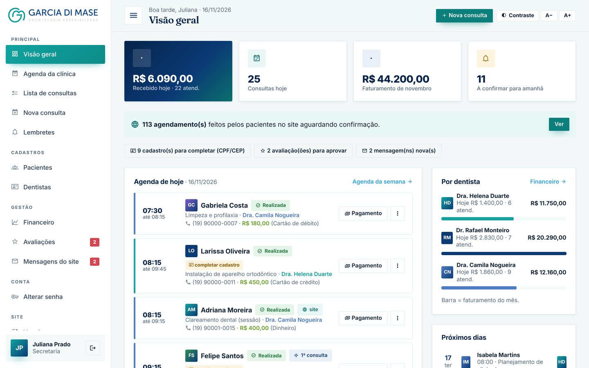<br><sub>Visão geral</sub></td>
<td width="50%"><br><sub>Agenda da clínica</sub></td>
</tr>
<tr>
<td width="50%">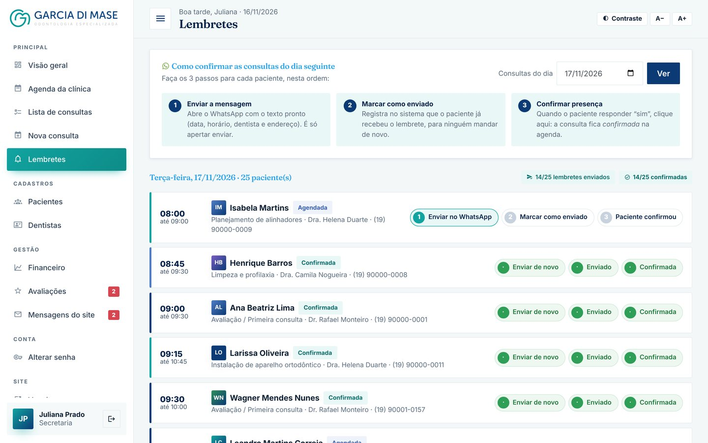<br><sub>Lembretes pelo WhatsApp</sub></td>
<td width="50%">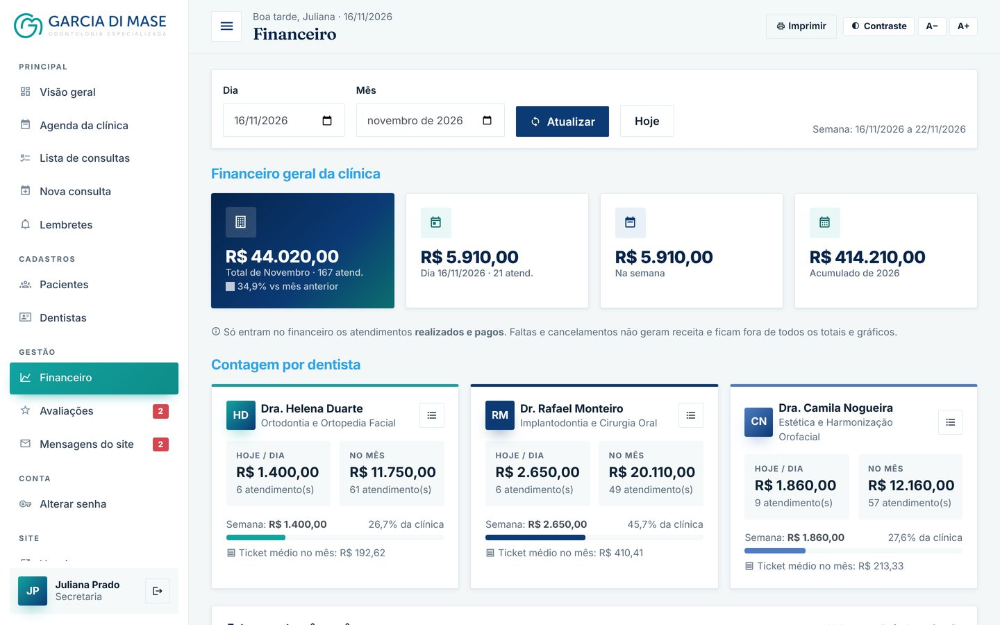<br><sub>Financeiro da clínica</sub></td>
</tr>
<tr>
<td colspan="2"><b>Área do dentista</b></td>
</tr>
<tr>
<td width="50%">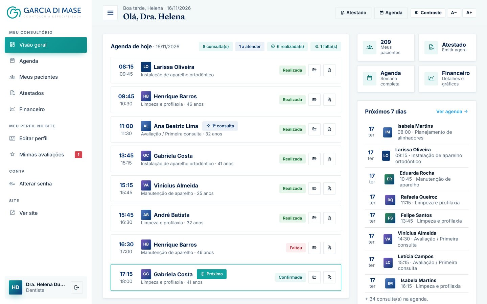<br><sub>Agenda de hoje</sub></td>
<td width="50%">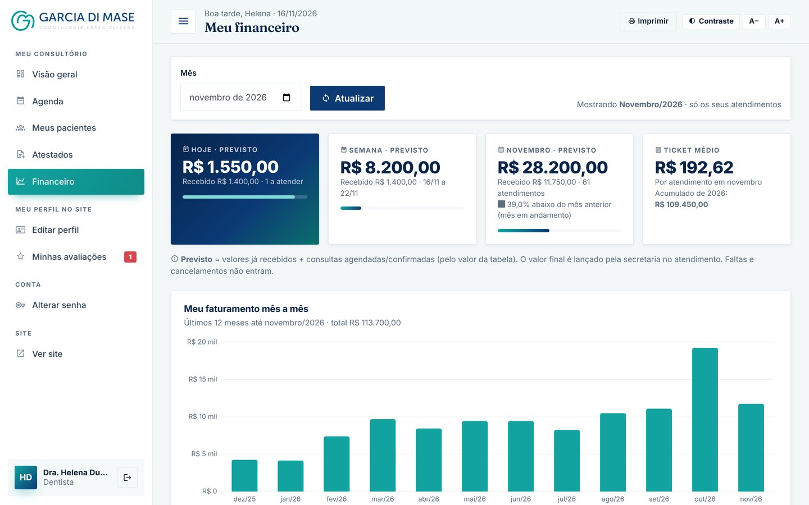<br><sub>Meu financeiro</sub></td>
</tr>
<tr>
<td width="50%">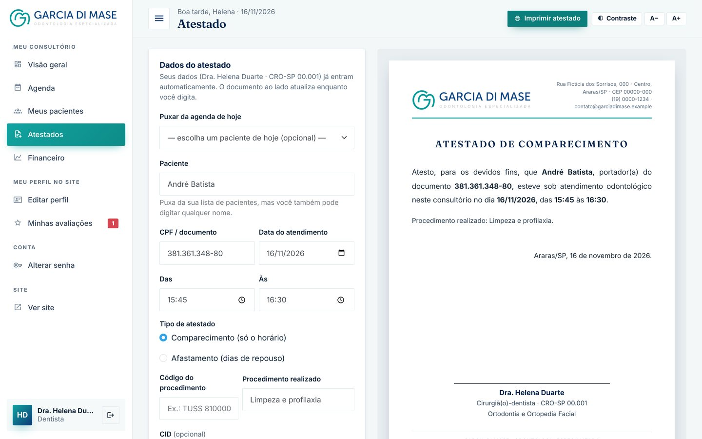<br><sub>Gerador de atestado</sub></td>
<td width="50%"><br><sub>Prontuário e odontograma</sub></td>
</tr>
</table>

<div align="center">
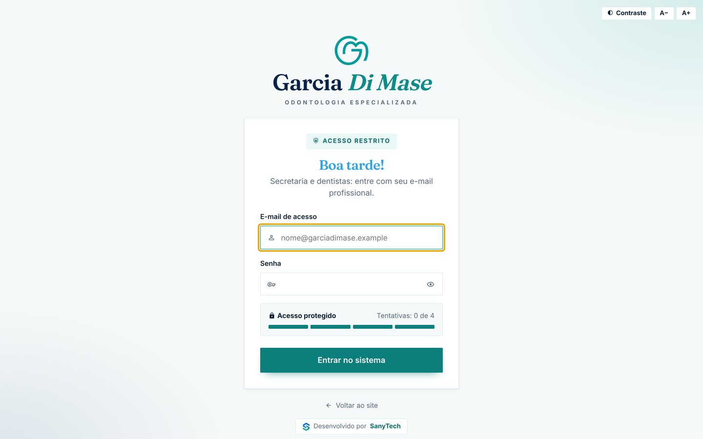
&nbsp;

<br>
<sub>Login da área restrita · Página inicial no celular</sub>
</div>

<p align="right"><a href="#topo">voltar ao topo ↑</a></p>

---

## Arquitetura

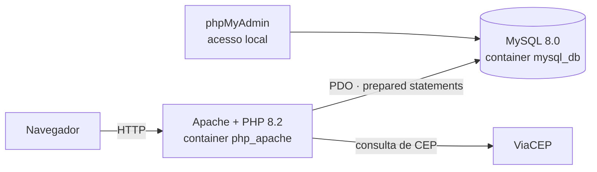

### Fluxo de atendimento

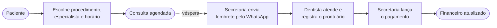

### Tecnologias

| Camada | Tecnologias |
|:--|:--|
| Back-end | PHP 8.2 (PDO, orientação a objetos) e Apache |
| Banco de dados | MySQL 8.0 e phpMyAdmin |
| Front-end | HTML5, CSS3, JavaScript, Bootstrap 5.3, Bootstrap Icons e Chart.js |
| Infraestrutura | Docker e Docker Compose |
| Integração | ViaCEP (endereço automático pelo CEP) |

<p align="right"><a href="#topo">voltar ao topo ↑</a></p>

---

## Como executar

### Pré-requisitos

- [Docker Desktop](https://www.docker.com/products/docker-desktop/) instalado e em execução (*Engine running*)
- Virtualização ativada no computador (exigência do Docker no Windows)
- [Git](https://git-scm.com/) e, opcionalmente, o [VS Code](https://code.visualstudio.com/)

### Instalação

```bash
# 1. Clone o repositório
git clone https://github.com/karlakcvs/ProjetoClinicaOdontologica2026.git
cd ProjetoClinicaOdontologica2026
```

Crie o arquivo `.env` na raiz com valores privados:
```dotenv
MYSQL_ROOT_PASSWORD=troque-por-uma-senha-forte
MYSQL_DATABASE=barbearia
MYSQL_USER=clinica
MYSQL_PASSWORD=troque-por-outra-senha-forte
```

```bash
# 3. Suba os containers
docker compose up -d --build
```

O arquivo `.env` é local e não deve ser enviado ao GitHub.

| Serviço | Endereço |
|:--|:--|
| Site | http://localhost |
| Área restrita | http://localhost/login.php |
| phpMyAdmin | http://localhost:8888 (usuário `root` e senha definida no `.env`) |

> [!TIP]
> Na primeira visita, o sistema cria o banco de dados automaticamente, com dentistas, procedimentos e uma agenda de demonstração. Se aparecer erro de conexão, aguarde cerca de um minuto para o MySQL terminar de iniciar e atualize a página.

<details>
<summary><b>Problemas comuns</b></summary>
<br>

| Problema | Solução |
|:--|:--|
| `Virtualization support not detected` | Ative a virtualização (Intel VT-x / AMD SVM) na BIOS e execute `wsl --install` no PowerShell como administrador |
| `port is already allocated` | Feche programas que usam a porta 80 (XAMPP, Skype etc.) e execute `docker compose up -d` novamente |
| `container name ... is already in use` | Execute `docker compose down` e depois `docker compose up -d --build` |
| "E-mail ou senha inválidos" | Redefina a senha com o comando da seção [Perfis de acesso](#perfis-de-acesso); ele também libera o bloqueio |
| O site não mostra as alterações | Atualize com **Ctrl + F5** e confira se o Docker está rodando a partir desta pasta |

Comandos úteis: `docker compose ps` (status), `docker compose logs web` (erros do PHP) e `docker compose down` (desliga, mantendo os dados).

</details>

Instruções detalhadas em [LEIA-ME.md](../LEIA-ME.md). O banco é criado e inicializado pelo sistema na primeira execução.

<p align="right"><a href="#topo">voltar ao topo ↑</a></p>

---

## Perfis de acesso

| Perfil | E-mail de acesso | Página inicial |
|:--|:--|:--|
| Secretaria | `secretaria@garciadimase.example` | Visão geral da clínica |
| Dra. Helena Duarte – Ortodontia | `helena.duarte@garciadimase.example` | Agenda de hoje |
| Dr. Rafael Monteiro – Implantodontia | `rafael.monteiro@garciadimase.example` | Agenda de hoje |
| Dra. Camila Nogueira – Estética | `camila.nogueira@garciadimase.example` | Agenda de hoje |
| Equipe SanyTech | `ti@sanytech.example` | Painel técnico (`/sanytech.php`) |

As senhas **não são armazenadas no repositório**; o banco guarda apenas o *hash*. Para definir a senha de uma conta, com o site já aberto ao menos uma vez:

```bash
docker exec -it php_apache php /var/www/html/include/redefinir_senha.php secretaria@garciadimase.example "SuaSenha#Forte2026"
```

A senha deve ter no mínimo 10 caracteres, com letra maiúscula, letra minúscula, número e símbolo.

---

## Estrutura do projeto

```
ProjetoClinicaOdontologica2026/
├── README-com-imagens/       Telas usadas neste README
├── src/
│   ├── api/                  Horários livres (JSON)
│   ├── assets/               CSS, JavaScript e imagens
│   ├── classes/              Agendamento, financeiro e prontuário (POO)
│   ├── include/              Configuração, segurança e migrações (bloqueada ao navegador)
│   ├── uploads/              Arquivos enviados (não versionados)
│   ├── index.php             Página inicial
│   ├── agendar.php           Agendamento online
│   ├── painel.php            Secretaria: visão geral
│   ├── financeiro.php        Secretaria: financeiro da clínica
│   ├── dent_painel.php       Dentista: agenda de hoje
│   ├── dent_financeiro.php   Dentista: meu financeiro
│   ├── dent_atestado.php     Dentista: gerador de atestado
│   └── ...                   Demais telas da secretaria, dos dentistas e da SanyTech
├── gestao-software-sanytech-garcia-di-mase.html   Registro de alterações e plano de testes
├── docker-compose.yml
├── Dockerfile
└── .env                      Configuração local (não versionada)
```

---

## Segurança

| Proteção | Implementação |
|:--|:--|
| Senhas | Armazenadas apenas como *hash* (`password_hash`) |
| Formulários | Token CSRF em todos os formulários e sessão protegida |
| Força bruta | Bloqueio após 4 tentativas no login e nos formulários públicos; limite de requisições na API (HTTP 429) |
| SQL injection | Consultas com *prepared statements* (PDO) |
| Controle de acesso | Cada perfil acessa apenas as próprias telas; o dentista vê somente os próprios pacientes, atestados e valores |
| Arquivos | Pastas internas e arquivos do prontuário bloqueados ao acesso direto |
| Banco de dados | MySQL e phpMyAdmin acessíveis somente no próprio computador |
| Servidor | Cabeçalhos de segurança no Apache e versão do PHP oculta |

Detalhes em [SEGURANCA.md](../SEGURANCA.md).

> [!WARNING]
> Nunca publique arquivos `.env`, bancos locais (`database/` ou `mysql-data/`) ou o conteúdo de `src/uploads/`: eles podem conter senhas, dados pessoais e informações de saúde. O `.gitignore` do projeto os exclui.

---

## Documentação

| Documento | Conteúdo |
|:--|:--|
| [gestao-software-sanytech-garcia-di-mase.html](../gestao-software-sanytech-garcia-di-mase.html) | Organização e Gestão de Software: registro de alterações com motivos, arquivos alterados, plano de testes e aprovação (baixe e abra no navegador) |
| [LEIA-ME.md](../LEIA-ME.md) | Instalação detalhada e histórico de versões |
| [SEGURANCA.md](../SEGURANCA.md) | Medidas de segurança do sistema |

### Versão final · novembro de 2026
- Nova página inicial com fotografia em tela cheia e menu transparente sobre a imagem
- Contraste e tamanho do texto sempre visíveis no menu principal; no alto contraste, a página inicial segue o padrão do contraste (fundo preto, texto branco e destaques amarelos)
- Revisão de responsividade em celular, tablet e computador
- Área do dentista reorganizada: agenda do dia na entrada, página **Meu financeiro** e **gerador de atestados**
- Financeiro da secretaria simplificado, com o gráfico mês a mês em largura total
- Utilitário de recriação de senha desativado; senhas definidas apenas por `redefinir_senha.php`

---

## Autoria

<table>
<tr>
<td align="center">
<a href="https://github.com/karlakcvs">
<br>
<sub><b>Karla Carolina Vicente de Sousa</b></sub>
</a><br>
<sub>Desenvolvimento full stack</sub>
</td>
</tr>
</table>

Desenvolvido pela **SanyTech** · Projeto Integrador · Desenvolvimento de Software Multiplataforma · Fatec Araras · 2026

<div align="center">
<br>

<br>
<sub>Projeto acadêmico. Clínica, profissionais e pacientes são fictícios; as fotografias são ilustrativas.</sub>
</div>
