<a id="topo"></a>

<div align="center">

<picture>
  <source media="(prefers-color-scheme: dark)" srcset="src/assets/img/logo-horizontal-branco.png">
  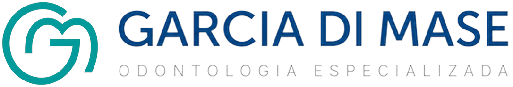
</picture>

<h2>Seu sorriso merece cuidado <i>especializado</i>.</h2>

<p>
  <b>Sistema de agendamento e gestão para clínica odontológica</b><br>
  Site para pacientes &nbsp;·&nbsp; Área restrita para secretaria, dentistas e equipe técnica
</p>

<br>


<br>

<a href="#-sobre-o-projeto">Sobre</a> &nbsp;•&nbsp;
<a href="#-funcionalidades">Funcionalidades</a> &nbsp;•&nbsp;
<a href="#-telas">Telas</a> &nbsp;•&nbsp;
<a href="#-como-funciona">Como funciona</a> &nbsp;•&nbsp;
<a href="#-como-executar">Como executar</a> &nbsp;•&nbsp;
<a href="#-perfis-de-acesso">Acesso</a> &nbsp;•&nbsp;
<a href="#-segurança">Segurança</a> &nbsp;•&nbsp;
<a href="#-documentação-do-projeto">Documentação</a> &nbsp;•&nbsp;
<a href="#-novidades">Novidades</a>

</div>

<br>

<div align="center">
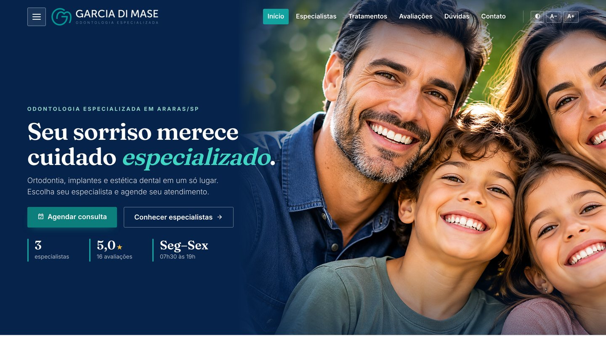
</div>

<br>

<table align="center">
<tr>
<td align="center" width="20%"><h2>4</h2><sub>passos para agendar<br>uma consulta online</sub></td>
<td align="center" width="20%"><h2>3</h2><sub>especialistas com<br>agenda própria</sub></td>
<td align="center" width="20%"><h2>4</h2><sub>perfis de acesso<br>separados</sub></td>
<td align="center" width="20%"><h2>1 clique</h2><sub>para emitir um<br>atestado em PDF</sub></td>
<td align="center" width="20%"><h2>100%</h2><sub>responsivo: celular,<br>tablet e computador</sub></td>
</tr>
</table>

---

## 🦷 Sobre o projeto

O **Garcia Di Mase** é um sistema web completo para uma clínica odontológica **fictícia** de Araras/SP.
O paciente agenda a consulta online em poucos passos, e a clínica organiza agenda, prontuários,
financeiro, atestados e avaliações em um só lugar.

Projeto desenvolvido pela **SanyTech** no Projeto Integrador do curso de
**Desenvolvimento de Software Multiplataforma (DSM) – Fatec Araras**, 2026.2.

> [!NOTE]
> Todos os dados (nomes, telefones, e-mails, CROs, endereço e pacientes) são **fictícios** e servem apenas para demonstração.

---

## ✨ Funcionalidades

<table>
<tr>
<td width="50%" valign="top">

### 🌐 Site do paciente
- Página inicial com **foto em tela cheia** e toda a informação principal na primeira tela
- **Agendamento online em 4 passos**: procedimento → especialista → data/horário → dados
- Horários livres calculados pela **duração do procedimento** e pela agenda de cada dentista
- **Perfil de cada especialista**: formação, experiência, horários, tratamentos e antes e depois
- **Procedimentos e valores** de referência e formas de pagamento
- **Avaliações com estrelas**, aprovadas pela secretaria antes de aparecer no site
- Formulário **Fale conosco**

</td>
<td width="50%" valign="top">

### 🗂️ Secretaria
- **Agenda semanal** colorida por tipo de procedimento
- Cadastro de pacientes com **CPF** e **CEP automático** (ViaCEP)
- **Resumo do paciente**: histórico, valores pagos e consultas
- **Financeiro** com faturamento mês a mês, comparativo por ano e faturamento diário
- Lembretes de consulta, mensagens do site e moderação de avaliações
- Tabela de **procedimentos, preços e durações** editável

</td>
</tr>
<tr>
<td width="50%" valign="top">

### 👩‍⚕️ Dentistas
- **Agenda de hoje** logo na entrada, com o próximo paciente destacado
- **Meu financeiro**: previsto do dia, da semana e do mês, gráfico de 12 meses, procedimentos, formas de pagamento, a receber e recebidos
- **Gerador de atestado** (comparecimento ou afastamento): nome e CRO do dentista já preenchidos, paciente puxado da agenda ou digitado, código do procedimento, dias de afastamento e impressão em PDF
- **Prontuário** com odontograma interativo, fotos por sessão, exames (PDF/imagem) e observações
- Cada dentista vê **somente os seus pacientes e valores**

</td>
<td width="50%" valign="top">

### 🛠️ Equipe técnica SanyTech
- Área própria para acompanhar **funcionamento, velocidade e segurança** do sistema
- Acesso separado do restante da clínica, com login forte

### ♿ Acessibilidade
- **Alto contraste** e ajuste do **tamanho do texto** (A− / A+) sempre visíveis no menu
- Link "pular para o conteúdo" e navegação completa por teclado
- Contraste que preserva a foto e mantém o texto legível

</td>
</tr>
</table>

<p align="right"><a href="#topo">⬆ voltar ao topo</a></p>

---

## 📸 Telas

<table>
<tr>
<td align="center" width="50%"><b>Página inicial</b><br><br></td>
<td align="center" width="50%"><b>Nossos especialistas</b><br><br>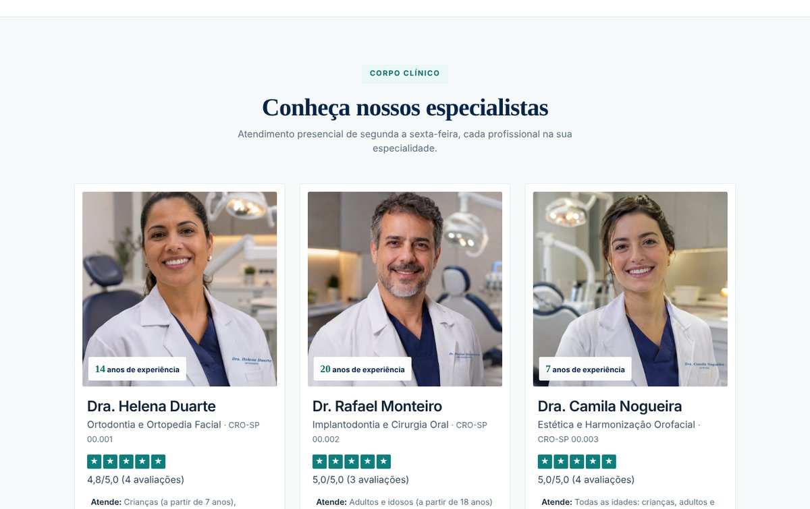</td>
</tr>
<tr>
<td align="center"><b>Perfil do especialista</b><br><br>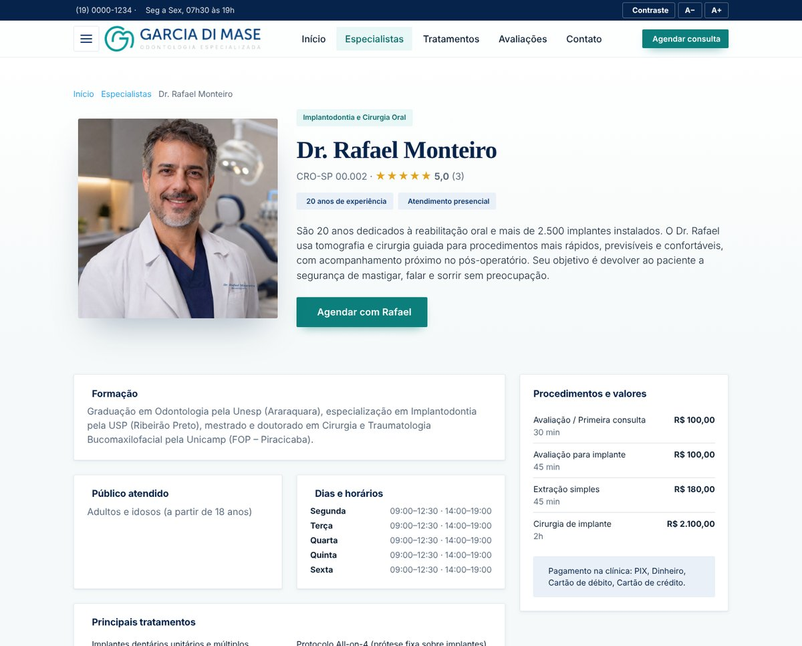</td>
<td align="center"><b>Agendamento online</b><br><br>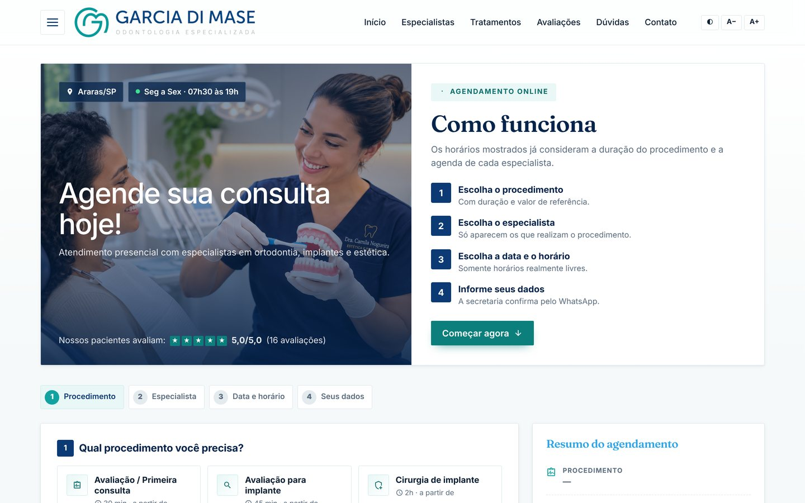</td>
</tr>
<tr>
<td align="center"><b>Agenda do dentista</b><br><br>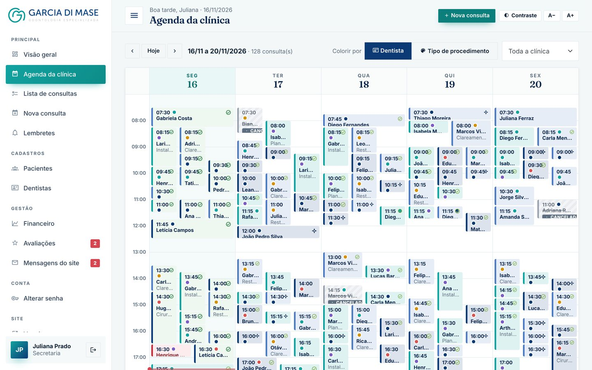</td>
<td align="center"><b>Prontuário e odontograma</b><br><br>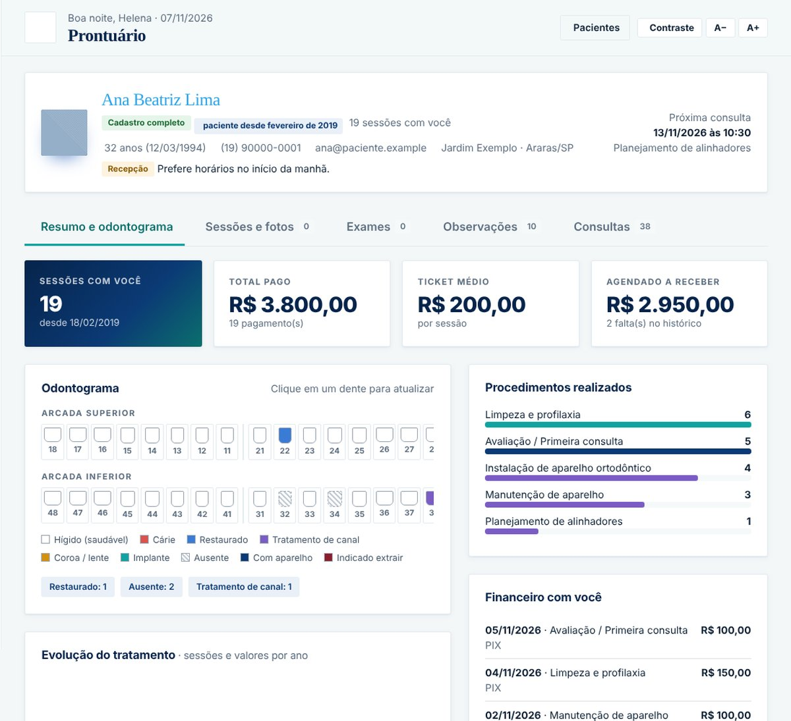</td>
</tr>
</table>

---

## 🔄 Como funciona

### O caminho do paciente

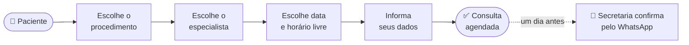

### O dia do dentista

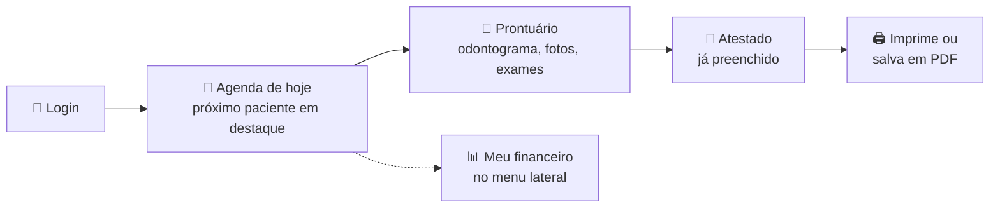

### Quem acessa o quê

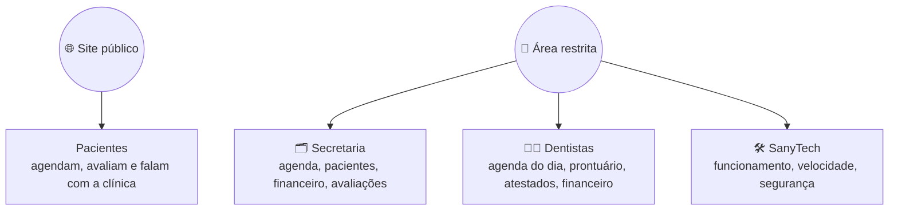

### Arquitetura

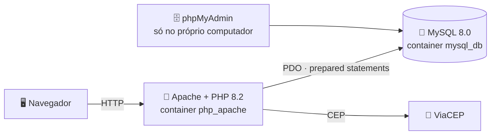

<p align="right"><a href="#topo">⬆ voltar ao topo</a></p>

---

## 🧰 Tecnologias

| Camada | Tecnologias |
|---|---|
| **Back-end** | PHP 8.2 (PDO, orientação a objetos), Apache |
| **Banco de dados** | MySQL 8.0 · phpMyAdmin |
| **Front-end** | HTML5, CSS3, JavaScript, Bootstrap 5.3, Bootstrap Icons, Chart.js |
| **Tipografia** | Fraunces (títulos) e Plus Jakarta Sans (textos) |
| **Infraestrutura** | Docker e Docker Compose |
| **Integrações** | ViaCEP (preenchimento automático de endereço) |

---

## 🚀 Como executar

### Pré-requisitos
- [Docker Desktop](https://www.docker.com/products/docker-desktop/) instalado e aberto ("Engine running")
- Virtualização ativada no computador (exigida pelo Docker no Windows)
- [VS Code](https://code.visualstudio.com/) (opcional, mas recomendado)

### Passo a passo

**1. Clone o repositório**
```bash
git clone https://github.com/karlakcvs/ProjetoClinicaOdontologica2026.git
cd ProjetoClinicaOdontologica2026
```

**2. Crie o arquivo de configuração**
```bash
cp .env.example .env        # Windows (CMD): copy .env.example .env
```
Abra o `.env` e troque as senhas `change-this-...` por senhas suas.

**3. Suba os containers**
```bash
docker compose up -d --build
```

**4. Acesse**

| Serviço | Endereço |
|---|---|
| 🌐 Site | http://localhost |
| 🔐 Área restrita | http://localhost/login.php |
| 🗄️ phpMyAdmin | http://localhost:8888 (usuário `root`, senha do `.env`) |

> [!TIP]
> Na primeira visita, o sistema **cria o banco sozinho**: tabelas, dentistas, procedimentos e uma agenda de demonstração.
> Se aparecer erro de conexão, aguarde cerca de 1 minuto (o MySQL ainda está iniciando) e atualize a página.

<details>
<summary><b>🧯 Problemas comuns</b></summary>
<br>

| Problema | Solução |
|---|---|
| `Virtualization support not detected` | Ative a virtualização (Intel VT-x / AMD SVM) na BIOS e rode `wsl --install` no PowerShell como administrador |
| `port is already allocated` (porta 80 ocupada) | Feche XAMPP, Skype ou outro programa que use a porta 80 e rode `docker compose up -d` de novo |
| `container name ... is already in use` | `docker rm -f php_apache mysql_db phpmyadmin` e depois `docker compose up -d --build` |
| Erro de conexão com o banco na primeira vez | Aguarde ~1 minuto (o MySQL ainda está iniciando) e atualize a página |
| "E-mail ou senha inválidos" | Defina a senha com o comando da seção [Perfis de acesso](#-perfis-de-acesso) (ele também libera o bloqueio) |
| O site não mostra as mudanças | Atualize com **Ctrl + F5** e confira se o Docker está rodando a partir desta pasta |
| Ver o que está rodando | `docker compose ps` |
| Ver erros do PHP | `docker compose logs web` |
| Desligar | `docker compose down` (os dados ficam salvos) |

</details>

Instruções detalhadas em [LEIA-ME.md](LEIA-ME.md). O banco de demonstração para importação está em [database/](database/).

<p align="right"><a href="#topo">⬆ voltar ao topo</a></p>

---

## 👥 Perfis de acesso

| Perfil | E-mail de acesso | Entra em |
|---|---|---|
| 🗂️ Secretaria – Juliana Prado | `secretaria@garciadimase.example` | Visão geral da clínica |
| 👩‍⚕️ Dra. Helena Duarte – Ortodontia | `helena.duarte@garciadimase.example` | Agenda de hoje |
| 👨‍⚕️ Dr. Rafael Monteiro – Implantodontia | `rafael.monteiro@garciadimase.example` | Agenda de hoje |
| 👩‍⚕️ Dra. Camila Nogueira – Estética | `camila.nogueira@garciadimase.example` | Agenda de hoje |
| 🛠️ Equipe SanyTech | `ti@sanytech.example` | Painel técnico (`/sanytech.php`) |

As senhas **não ficam no repositório**: o banco guarda só o *hash*. Para definir a senha de uma conta (com o site já aberto ao menos uma vez):

```bash
docker exec -it php_apache php /var/www/html/include/redefinir_senha.php secretaria@garciadimase.example "SuaSenha#Forte2026"
```

A senha precisa ter no mínimo **10 caracteres**, com maiúscula, minúscula, número e símbolo. O comando também libera o login bloqueado por excesso de tentativas.

---

## 📁 Estrutura do projeto

```
📦 ProjetoClinicaOdontologica2026
 ┣ 📂 database                  → banco de demonstração (dados fictícios)
 ┣ 📂 README-com-imagens        → imagens deste README
 ┣ 📂 src
 ┃ ┣ 📂 api                     → horários livres (JSON)
 ┃ ┣ 📂 assets                  → CSS, JavaScript e imagens
 ┃ ┣ 📂 classes                 → agendamento, financeiro e prontuário (POO)
 ┃ ┣ 📂 include                 → configuração, segurança e migrações (bloqueada ao navegador)
 ┃ ┣ 📂 uploads                 → fotos e arquivos enviados (não versionados)
 ┃ ┣ 📜 index.php               → página inicial
 ┃ ┣ 📜 agendar.php             → agendamento online
 ┃ ┣ 📜 financeiro.php          → financeiro da secretaria
 ┃ ┣ 📜 dent_painel.php         → dentista: agenda de hoje
 ┃ ┣ 📜 dent_financeiro.php     → dentista: meu financeiro
 ┃ ┣ 📜 dent_atestado.php       → dentista: gerador de atestado
 ┃ ┗ 📜 ...                     → demais painéis da secretaria, dos dentistas e da SanyTech
 ┣ 📄 gestao-software-sanytech-garcia-di-mase.html → registro de alterações e plano de testes
 ┣ 🐳 Dockerfile
 ┣ 🐳 docker-compose.yml
 ┗ 📄 .env.example              → modelo de configuração
```

---

## 🔒 Segurança

| Proteção | Como funciona |
|---|---|
| 🔑 **Senhas** | Guardadas apenas como **hash** (`password_hash`) |
| 🛡️ **Formulários** | **Proteção CSRF** em todos eles e **sessão protegida** |
| 🤖 **Robôs e força bruta** | **Limite de 4 tentativas** no login e nos formulários públicos |
| 💉 **SQL injection** | Consultas com **prepared statements** |
| 👩‍⚕️ **Dados por dentista** | Agenda, prontuário, atestado e financeiro mostram só os dados do dentista logado |
| 📁 **Arquivos** | Pastas internas e prontuários **bloqueados** ao acesso direto pelo navegador |
| 🏠 **Banco de dados** | MySQL e phpMyAdmin acessíveis **somente no próprio computador** (`127.0.0.1`) |
| 🧱 **Servidor** | Cabeçalhos de segurança no Apache e versão do servidor oculta |

Detalhes em [SEGURANCA.md](SEGURANCA.md).

> [!WARNING]
> Nunca publique o arquivo `.env`, a pasta `mysql-data/` nem o conteúdo de `src/uploads/`:
> eles podem conter senhas, dados pessoais e informações de saúde. O `.gitignore` do projeto já os deixa de fora.

---

## 📑 Documentação do projeto

| Documento | Conteúdo |
|---|---|
| [gestao-software-sanytech-garcia-di-mase.html](gestao-software-sanytech-garcia-di-mase.html) | Organização e gestão do software: registro de alterações com motivos, arquivos alterados e plano de testes (baixe e abra no navegador) |
| [LEIA-ME.md](LEIA-ME.md) | Instalação detalhada e histórico de versões |
| [SEGURANCA.md](SEGURANCA.md) | Medidas de segurança do sistema |
| [database/README.md](database/README.md) | Banco de demonstração |

---

## 🆕 Novidades

**Novembro de 2026**
- 🖼️ **Nova página inicial**: foto da família em tela cheia, título "Seu sorriso merece cuidado especializado." e toda a informação principal visível sem rolar
- 🧭 **Menu sobre a foto**: transparente no topo, fica branco com o logo colorido ao rolar a página
- ♿ **Acessibilidade sempre à mão**: Contraste, A− e A+ no próprio menu; o contraste preserva a foto
- 🦷 **Área do dentista reorganizada**: agenda do dia no topo e financeiro em página própria no menu lateral
- 📝 **Atestado odontológico**: comparecimento ou afastamento, pronto para imprimir ou salvar em PDF
- 📊 **Financeiro da secretaria mais limpo**: gráfico de barras "Faturamento mês a mês" na largura toda

<p align="right"><a href="#topo">⬆ voltar ao topo</a></p>

---

## 👩‍💻 Autora

<table>
<tr>
<td align="center">
<a href="https://github.com/karlakcvs">
<br>
<sub><b>Karla Carolina Vicente de Sousa</b></sub>
</a><br>
<sub>Desenvolvimento full stack</sub>
</td>
</tr>
</table>

Desenvolvido com 💙 pela **SanyTech** · Projeto Integrador · DSM · Fatec Araras · 2026.2

---

<div align="center">

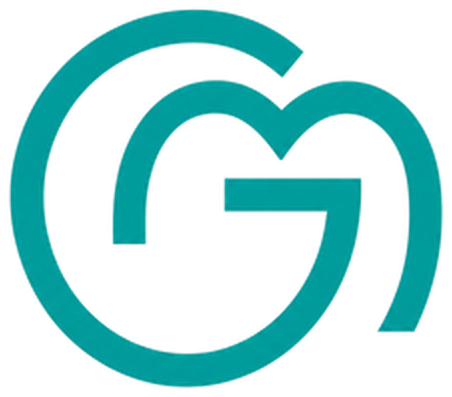

<sub>Projeto acadêmico · Clínica, profissionais e pacientes são fictícios · Fotos ilustrativas</sub>

</div>
